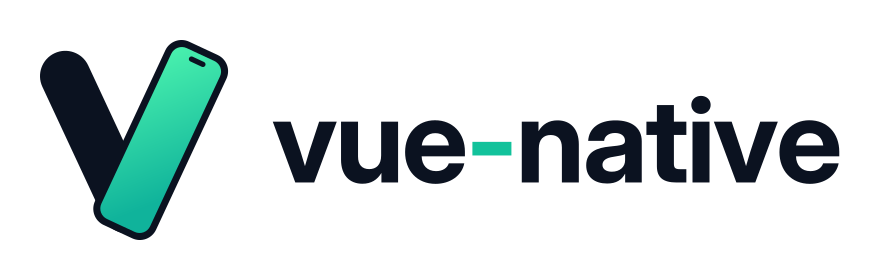

<p align="center">
  <picture>
    <source media="(prefers-color-scheme: dark)" srcset=".github/logo-horizontal-dark.svg" />
    
  </picture>
</p>

<p align="center">Vue for real native apps on iOS and Android.</p>

nativue renders Vue components as the platform's own views: UIKit on iOS, Android views with
Material 3 on Android. There is no web view. You write the Vue you already know, with single-file
components, `ref`, `computed` and TypeScript, and the app looks and feels native on both platforms.

```vue
<script setup lang="ts">
import { ref } from 'vue'

const count = ref(0)
</script>

<template>
  <SafeAreaView :style="{ flex: 1, alignItems: 'center', justifyContent: 'center', gap: 16 }">
    <Text :style="{ fontSize: 32, fontWeight: '700' }">{{ count }}</Text>
    <Button title="Add one" @press="count++" />
  </SafeAreaView>
</template>
```

## What you get

- **Native components:** `View`, `Text`, `Image`, `TextInput`, `ScrollView`, `FlatList`, `Modal`,
  `Switch` and more, laid out with flexbox (Yoga).
- **File-based navigation:** native stacks, tab bars, sheets and modals, with deep links.
- **Animations and gestures** that run natively, without JavaScript on every frame.
- **Styling** with style objects, or Tailwind CSS classes through `@nativue/tailwind`.
- **2,000+ icons** with `@nativue/icons`, drawn natively.
- **Hot reload:** save a file and the app updates, keeping its screens and state, on simulators,
  emulators and phones.
- **Dev tooling:** errors show on a red screen, with the stack mapped to your files.
- **Your own native code:** packages can add native functions and views, in Swift and Kotlin.

## Requirements

- Node.js 20.19 or later
- iOS: a Mac with Xcode. Apps run on iOS 15.1 or later.
- Android: Android Studio. Apps run on Android 7.0 (API 24) or later.

## Create an app

```sh
npm create nativue@latest my-app
cd my-app
npm install
npm run ios        # or: npm run android
```

`npm run ios` and `npm run android` build the app and open it on a simulator or emulator, starting
one if none is running. Then they keep the dev server running: save a file and the app reloads.

To run on a phone, see [Getting started](docs/getting-started.md#run-on-a-phone).

## Documentation

- [Getting started](docs/getting-started.md): create, run, project structure, release builds
- [Components](docs/components/README.md): every component, its props, events and slots
- [Styling](docs/styling.md): styles, colors, dark mode, pressed and focused states
- [Navigation](docs/navigation.md): routes, stacks, tabs, modals, deep links
- [Animations and gestures](docs/animations.md)
- [APIs](docs/apis.md): storage, fetch, platform, keyboard, dimensions
- [Packages](docs/packages.md): icons, Tailwind, haptics, clipboard, SQLite, and writing your own with native code
- [Developing nativue](docs/development.md): run the demo app and work on the framework

## Packages

| Package                                     | What it is                                      |
| ------------------------------------------- | ----------------------------------------------- |
| [`@nativue/core`](packages/core)            | the framework: runtime, native side and CLI     |
| [`create-nativue`](packages/create-nativue) | `npm create nativue`, creates an app            |
| [`@nativue/icons`](packages/icons)          | icon sets as components                         |
| [`@nativue/tailwind`](packages/tailwind)    | Tailwind CSS classes, turned into native styles |
| [`@nativue/clipboard`](packages/clipboard)  | copying text to the clipboard                   |
| [`@nativue/haptics`](packages/haptics)      | haptic feedback                                 |
| [`@nativue/sqlite`](packages/sqlite)        | SQLite databases                                |

## License

[MIT](LICENSE)
